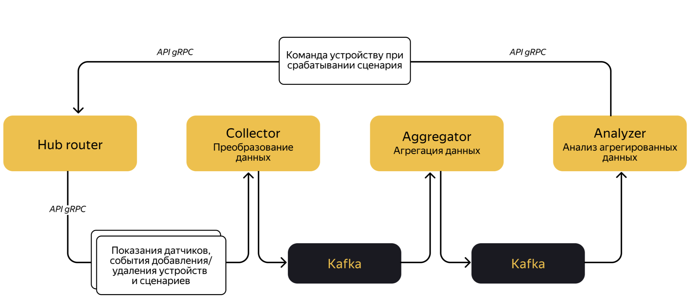

# Smart Home Telemetry Platform

Проект платформы для анализа телеметрии устройств умного дома. Система собирает данные с датчиков, агрегирует их, проверяет условия пользовательских сценариев и управляет устройствами через автоматизацию.

---

## 🔹 Основные функции

- **Сбор и обработка данных:** события от датчиков и хабов принимаются сервисом **Collector** и сохраняются в Kafka.
- **Агрегация:** **Aggregator** формирует актуальные снапшоты состояния устройств по каждому хабу.
- **Анализ сценариев:** **Analyzer** проверяет условия сценариев и отправляет команды хабу для выполнения действий.
- **Автоматизация умного дома:** управление светом, температурой, безопасностью и другими устройствами на основе настроек пользователя.
---

## 🔹 Архитектура

---

## 🔹 Kafka topics

- `telemetry.sensors.v1` — события от датчиков.
- `telemetry.hubs.v1` — события от хабов.
- `telemetry.snapshots.v1` — агрегированные состояния устройств.
---

## 🔹 Сервисы

- Collector — принимает события от датчиков и хабов, валидирует и публикует их в Kafka.
- Aggregator — читает события из Kafka и формирует актуальный snapshot состояния хаба.
- Analyzer — анализирует snapshot и сценарии, после чего отправляет команды устройствам.
- Config Server — централизованное хранение конфигурации.
- Eureka Server — service discovery для микросервисов.
---

## 🔹 Технологии

- **Java 17 / Spring Boot** – сервисы микросервисной архитектуры
- **Apache Kafka** – обработка и хранение потоков данных
- **gRPC** – межсервисное взаимодействие
- **Avro / Protobuf** – бинарная сериализация телеметрии
- **Spring Cloud Config / Eureka** – централизованная конфигурация и сервис-дискавери
---

## 🔹 Что я изучил в проекте

- Event-driven architecture.
- Асинхронное взаимодействие сервисов через Kafka.
- gRPC-взаимодействие между микросервисами.
- Сериализацию данных через Avro и Protobuf.
- Централизованную конфигурацию через Spring Cloud Config.
- Service discovery через Eureka.
---
